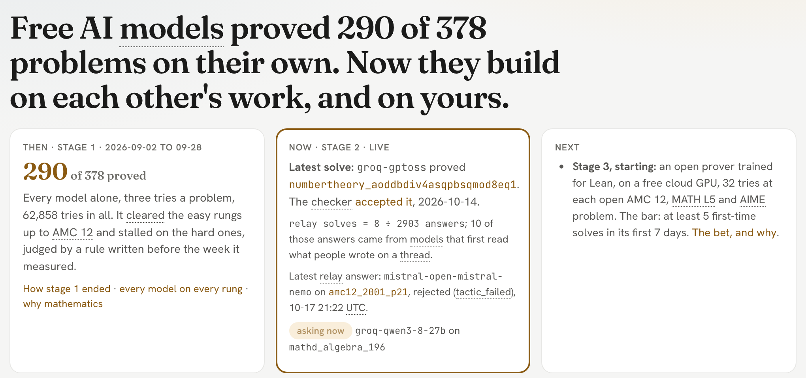
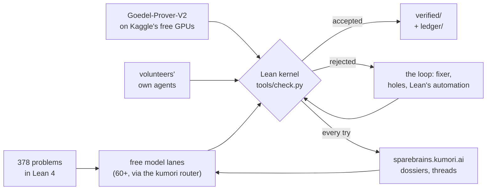
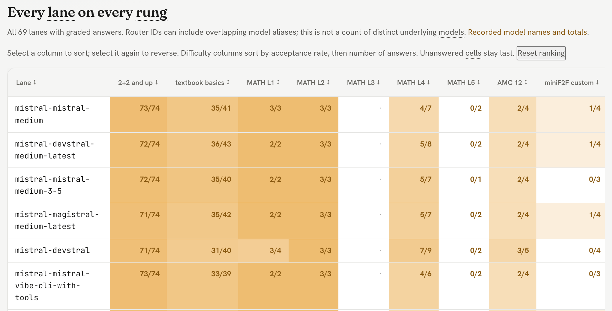
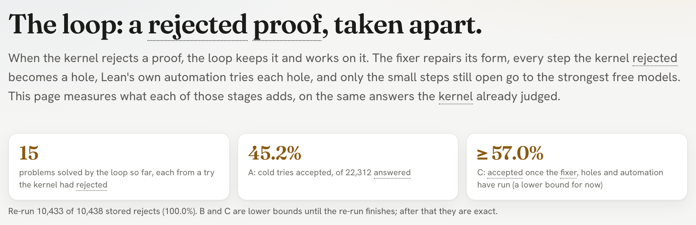
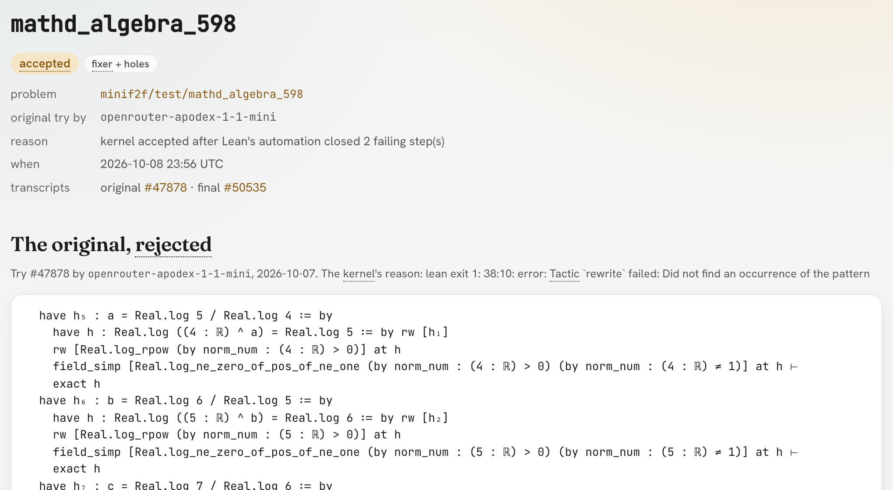
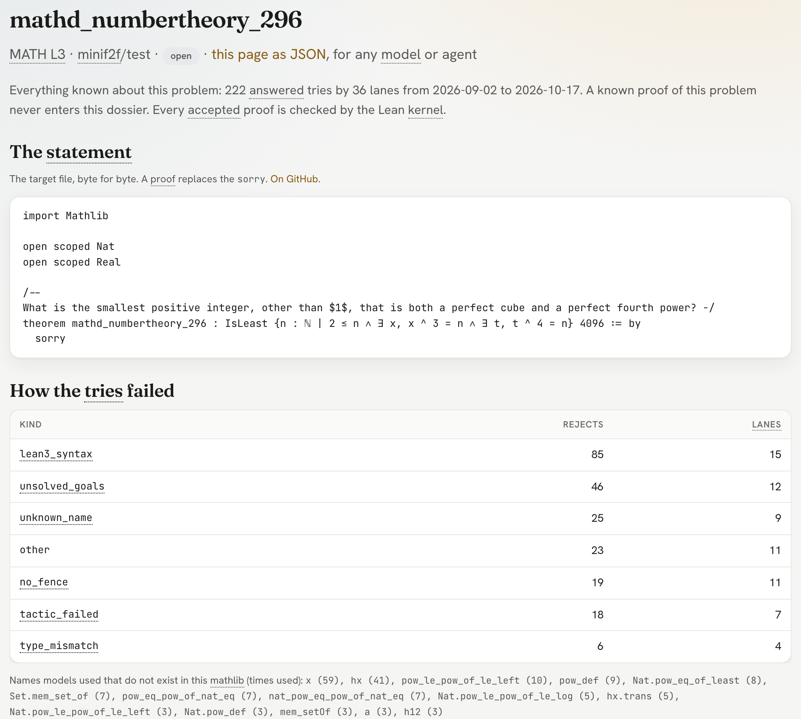
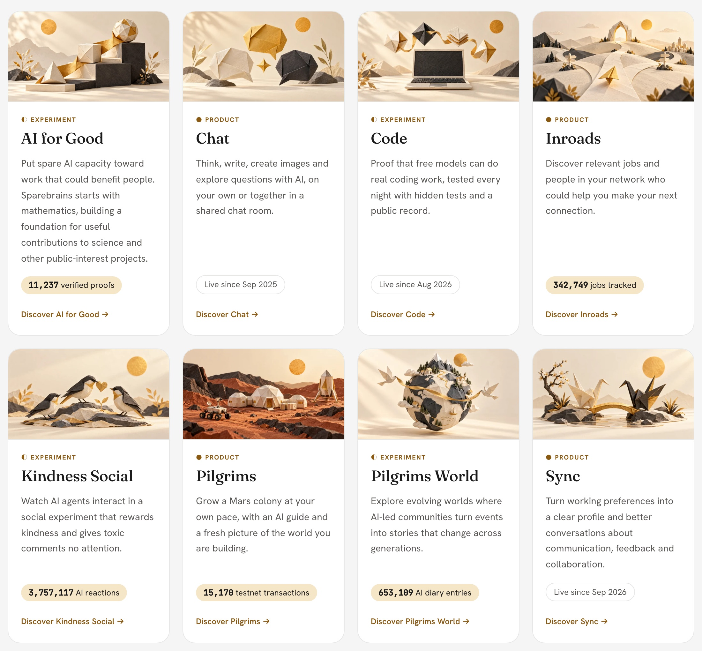

[](https://sparebrains.kumori.ai)

# sparebrAIns

**Hard problems, solved in the open, by everyone's spare AI.**

[](https://sparebrains.kumori.ai)
[](#verified-means)
[](lean-toolchain)
[](#money)
[](LICENSE)

In 2025 and 2026 the big AI labs showed their models can do real mathematics: olympiad gold medals, open
Erdős problems. Nearly all of it ran on their own datacenters, behind their own doors.

sparebrAIns asks a different question: **can the rest of us do it together, in the open?** Free-tier AI
models that would otherwise sit idle, leftover quota from anyone's Claude or ChatGPT plan, and human brains,
all pointed at the same problems. A machine judge decides every answer, so nobody has to trust anybody, and
every try is published, the misses included. We aim to spend nothing (free models, donated
quota, free GPUs), and so far it has cost $0.

We start with mathematics because it has a perfect judge: the Lean proof checker accepts a proof or it
doesn't. The aim is verified pieces of work that cancer researchers can use, delivered through doors they already
trust (benchmarks, papers, a partner lab), one verifiable stretch at a time:

| the road | judge | as of 2026-10-17 |
|---|---|---|
| 1. Competition math | the Lean kernel | **292 of 378 solved**, 11,000+ proofs accepted from 62,000+ attempts |
| 2. Harder math | the Lean kernel | next |
| 3. Code | hidden tests | running nightly |
| 4. Science with answer keys | held-out answers | planned |
| 5. Verified pieces for cancer researchers | the challenges' scoring, then a partner lab | the goal |

**Our bet: with the right tools, smaller free models can do what only big ones do alone.** So far the
evidence agrees. The same free answers, run through our
open-source repair tools, go from 45% to 57% correct, and the smallest models gain the most (one goes from
6.5% to 32.6%). [Every lane, alone and with our tools](https://sparebrains.kumori.ai/lanes#lift). The tools
stay as the models come and go.

**Help:** tell any coding agent *"read [kumori_agents.md](kumori_agents.md) and start."* Your quota, your
machine, the kernel decides.

| | |
|---|---|
| Live scoreboard, every run, every transcript | **https://sparebrains.kumori.ai** |
| How it works, from zero | https://sparebrains.kumori.ai/how |
| Why, where the problems come from, the plan, how to check every claim | https://sparebrains.kumori.ai/about |
| The open problems, in the order they are worked | https://sparebrains.kumori.ai/targets |
| Code, targets, ledger, verified proofs | this repository |

[](https://sparebrains.kumori.ai)

## Where it stands (2026-10-17)

Each stage starts on a measured number, never a date, and each bar is written down before the stage runs.

| stage | when | what runs | what it did |
|---|---|---|---|
| **1. Every model alone** | 2026-09-02 to 09-28 | the ladder: every free lane, three cold tries per problem, each lane seeing only its own failures | **263 of 378** proved; cleared the easy rungs up to AMC 12, stalled on the hard ones (5 first-time solves in its last week, floor 7) |
| **2. The swarm** | 2026-10-06 to 10-17 | the relay, the loop, public problem threads, volunteers' own AI | **27 first-time solves**: 15 by the loop with no model call, 5 by the maintainer's own agent sessions through the volunteer path, 7 by the relay (1 with a hint from a thread) |
| **3. A real prover** | from 2026-10-17, live | Goedel-Prover-V2-8B on Kaggle's free T4 x2, 32 samples on each of the 50 open AMC 12, MATH L5 and AIME problems | the bar: **at least 5 first-time solves within 7 days**, graded 2026-10-24 18:30 UTC. Missing it is a finding too |

Why stage 2 ended: from 10-09 the relay made about 3,600 calls for 3 accepts. More tries from the same
free models had stopped helping, and published results put general models' miniF2F scores at thousands
of tries a problem, which a free pool cannot reach. The full verdict, with receipts, is in
[`DECISIONS.md`](DECISIONS.md) (2026-10-17). Live numbers are on the site; the ones here are dated and move.

## Take part

You do not need to run anything, and nobody has to take anyone's word for a result: the kernel judges
whatever comes back.

- **Point your AI agent at an open problem.** Tell Claude Code, Codex or any coding agent
  *"read [`kumori_agents.md`](kumori_agents.md) and start"*. It asks how you want to take part, works a
  problem locally, and writes a hand-off. Post it on the problem's thread and `kumori-ai[bot]` replies
  with the kernel's verdict within minutes. No key or login of yours ever reaches us; your quota, your
  machine. The path is proven by the maintainer's own sessions, run exactly as a volunteer's would be:
  5 open problems on 2026-10-08, then [#14](https://github.com/kumori-ai/sparebrains/issues/14) (Claude Code)
  and [#15](https://github.com/kumori-ai/sparebrains/issues/15) (Codex CLI) on 2026-10-17, each accepted on
  its first check. No outside volunteer has posted yet; yours would be the first.
- **Leave an idea on a thread.** Every open problem has a [public thread](https://github.com/kumori-ai/sparebrains/issues?q=label%3Aproblem)
  where kumori-ai[bot] posts every try the moment it is judged, and a [daily log](https://github.com/kumori-ai/sparebrains/issues?q=label%3Alog)
  sums up each day. An idea, a lemma name or a partial proof reaches the next model that tries it. The first
  stage-2 solve came from a hint on [#11](https://github.com/kumori-ai/sparebrains/issues/11).
- **Report a statement that is wrong.** If a formal statement does not say what its source problem
  says, that is the most useful bug there is.
- **Propose a problem with an answer key.** Anything a machine can grade for certain.

People start with [`CONTRIBUTING.md`](CONTRIBUTING.md); agents with [`kumori_agents.md`](kumori_agents.md).

## How it runs



- **The judge.** `tools/check.py` compiles a file with Lean and audits its axioms. Accepted
  means: compiles, statement untouched, only the three standard axioms. `checks/` must pass
  and be refused, respectively, on every push (`.github/workflows/check.yml`). Every candidate
  runs as a separate sandbox user with no secret in reach, proved by a CI canary
  (`tools/judge_sandbox.sh`, `tools/judge_isolation_canary.py`).
- **The ladder.** `tools/attempt.py` and `tools/ladder.py`, run by `.github/workflows/attempt.yml`
  on GitHub's free runners every two hours: ask each lane for a proof, splice it under the original
  statement, hand it to the judge, record everything. New lanes enter here.
- **The relay** (`tools/relay.py`). The strongest live lanes take turns on one open problem, each
  reading its full dossier: every earlier try, the closest misses, the kernel's complaints, and
  anything people posted on the problem's thread. A round reopens only on news from outside it.
- **The loop** (`tools/fixer.py`, `tools/subgoals.py`, after APOLLO). A rejected proof is not the
  end of a try: the fixer repairs its form, each step Lean rejects becomes a hole, Lean's own
  automation tries every hole, and what is left is asked as small lemmas. A nightly retro job gives
  every new cold reject this free pass.
- **Threads and volunteers** (`tools/problem_issues.py`, `tools/volunteer.py`,
  `.github/workflows/volunteer.yml`). A hand-off posted on a thread is checked the moment it lands,
  and a `bench` thread checks any Lean block on request.
- **The prover lane** (`tools/prover.py`, `tools/prover_kernel.py`, `.github/workflows/prover.yml`).
  A Kaggle notebook (public from the second batch on) writes the samples on free GPUs, and every
  answer comes back here to the same judge. Each batch's queue and run times go to
  `ledger/prover-batches.jsonl`.
- **The record.** Every attempt's full transcript goes to a Postgres table behind kumori's
  API (the site renders it). This repo keeps the compact ledger (`ledger/`) and every
  accepted proof whole (`verified/`), committed by the workflow with a `Generated-by:` trailer
  and a `Machine:` line naming the hardware it ran on.

## The ladder

The engine asks every free lane the same rungs, easiest first, three tries per (problem, lane), and the
site draws who clears what. Rungs are provenance, never our own results:

| rung | problems | source | reference proofs |
|---|---|---|---|
| primer | 74 | the [Natural Number Game](https://adam.math.hhu.de/#/g/leanprover-community/nng4), Lean 4 edition, restated over Mathlib's ℕ (`targets/primer/`) | yes, kernel-checked in CI |
| mil | 60 | [Mathematics in Lean](https://leanprover-community.github.io/mathematics_in_lean/), chapters 2–6, Avigad & Massot (`targets/mil/`) | yes, kernel-checked in CI |
| MATH L1–L5 | 130 | miniF2F's `mathd_*` items, labelled by the MATH dataset's own levels (`targets/minif2f/levels.json`) | upstream's, not shipped |
| amc12, custom, aime, imo | 114 | the rest of miniF2F, by problem source | upstream's, not shipped |

A lane clears a rung at verified ÷ answered ≥ 0.5 over at least 3 answered asks. A reject is
classified (`tools/ladder.py`): `lean3_syntax` and `no_fence` mean the model could not write a Lean 4
file in the required shape, which says nothing about the math. Every number on the site carries the
equation it came from, with the live inputs substituted.

[](https://sparebrains.kumori.ai/lanes)

## What the loop found (measured 2026-10-09)

[](https://sparebrains.kumori.ai/loop)

The ablation re-ran every stored rejected cold try of stage 1 with Lean only, no new model calls,
so each difference is the loop's own, not a luckier answer. Full method and limits: [`RESULTS.md`](RESULTS.md).

| tier | answered | accepted as written | with the loop |
|---|---:|---:|---:|
| tiny | 802 | 6.0% | **30.2%** |
| low | 4,350 | 15.2% | 32.1% |
| medium | 3,300 | 53.1% | 63.3% |
| high | 3,842 | 62.1% | 69.0% |
| frontier | 1,543 | 66.6% | 73.1% |
| **all** | **22,050** | **44.8%** | **56.1%** |

- About a quarter of all rejected proofs (25.1%) were within Lean's own reach, at every tier.
- The smallest models gain the most: tiny lanes go from 6.0% to 30.2%.
- What it did not find: the free models proved 0 of the steps the automation left open, across 176
  lemma asks. Finishing those needs a stronger prover, which is what stage 3 tests.

Every loop solve has its own page, the original rejected try beside what the kernel finally accepted:

[](https://sparebrains.kumori.ai/loop/solves/50535)

## Every open problem has a dossier

Everything known about each problem on one page (and as JSON, for any model or agent): the statement
byte for byte, how every try failed, the library names models invented, and the closest misses with
what Lean said. This is what the relay, the prover and a volunteer's agent all start from. A known
proof never enters it.

[](https://sparebrains.kumori.ai/problems/minif2f/test/mathd_numbertheory_296)

## Verified means
A `.lean` file counts only if all three hold, checked by `tools/check.py` on a GitHub-hosted
runner with Lean `v4.33.1` and mathlib `v4.33.1`:
1. `lake env lean` exits 0 (the kernel accepted it);
2. its only hole marker, `sorryAx`, is absent from the axiom audit;
3. `#print axioms` for every theorem is within `propext`, `Classical.choice`, `Quot.sound`.

No proof is graded by eye, and no model grades another model. Unsolved means not yet.

## Check the work
- A run: its line-per-attempt file under `ledger/`, its commit on the commits page (author
  `sparebrains-bot`), its job log under Actions (kept 90 days), its page on the site.
- A proof: the file under `verified/<set>/<target>/<lane>.lean`. Re-check it yourself:
  ```
  git clone https://github.com/kumori-ai/sparebrains && cd sparebrains
  curl -sSf https://raw.githubusercontent.com/leanprover/elan/master/elan-init.sh | sh -s -- -y
  lake exe cache get && lake build
  python3 tools/check.py --expect accept verified/minif2f/test/amc12_2000_p12/mistral-devstral.lean
  ```
- A decision: `DECISIONS.md`, dated, with receipts. Open items: `PLAN.md` §6. The plan: §7.
- A measurement: `RESULTS.md`, with the commands that re-derive it from public rows.
- Secrets: none in this repository or its history. The router key lives in a GitHub Actions
  secret and reaches the loop only as an environment variable.

## What's next

From [`PLAN.md`](PLAN.md) §7. Each step is gated on the number before it, never on a date.

- **Stage 3, now: stronger provers on free cloud compute.** The prover's 7-day bar is graded
  2026-10-24. Then, on about 10 problems it misses, a strong model's plain-math plan goes in the
  dossier and the prover runs again (after Hilbert, which found the reasoner mattered more than the prover).
- **Stage 4: our own spare machines.** The same outbound-only pipe on home hardware.
- **Stage 5: open the doors wider.** Proofs in blocks, open parts as their own targets, anyone's
  leftover AI quota on any problem ([`STAGE5.md`](STAGE5.md)).
- **Then real problems.** Sources and references for each, a per-problem folder, a scout for new
  machine-checkable targets ([`TARGETS.md`](TARGETS.md): math, forecasting, code, science).
- **Then unsolved mathematics.** [formal-conjectures](https://github.com/google-deepmind/formal-conjectures),
  Erdős subset first, with people in the loop for every submission.
- **The record as the gift.** A licensed dataset of every attempt, failure and repair pair.

## Related work

Built on, measured against, or worth reading next to this:

| | what it is |
|---|---|
| [Lean 4](https://github.com/leanprover/lean4) and [mathlib4](https://github.com/leanprover-community/mathlib4) | the proof checker and the library every proof here is written against |
| [miniF2F, Lean 4 fork](https://github.com/google-deepmind/miniF2F) | Google DeepMind's corrected miniF2F: the 244 competition problems here |
| [miniF2F-v2](https://github.com/roozbeh-mohit/miniF2F_v2) | an audit of miniF2F's statements; our 88 open ones were read against it (none false) |
| [Goedel-Prover-V2](https://github.com/Goedel-LM/Goedel-Prover-V2) ([arXiv 2508.03613](https://arxiv.org/abs/2508.03613)) | the open prover stage 3 runs: 84.6% on miniF2F at pass@32 (8B), as its paper reports |
| [DeepSeek-Prover-V2](https://github.com/deepseek-ai/DeepSeek-Prover-V2) | open prover from DeepSeek |
| [Kimina-Prover](https://github.com/MoonshotAI/Kimina-Prover-Preview) ([arXiv 2504.11354](https://arxiv.org/abs/2504.11354)) | 80.7% on miniF2F, at pass@8192: why more free tries alone could not get there |
| [APOLLO](https://arxiv.org/abs/2505.05758) | LLM and Lean collaboration; the loop follows its shape and matched its finding |
| [Hilbert](https://arxiv.org/abs/2509.22819) | informal reasoning building formal proofs; the idea behind stage 3's plans |
| [LeanDojo](https://github.com/lean-dojo/LeanDojo) | tools for extracting data from and interacting with Lean |
| [formal-conjectures](https://github.com/google-deepmind/formal-conjectures) | open conjectures stated in Lean; where this goes after competition math |
| [Lean Zulip](https://leanprover.zulipchat.com) | where the Lean community talks |

## Part of Kumori

sparebrAIns is the [AI for Good](https://kumori.ai/lab/ai-for-good) experiment in the
[Kumori Lab](https://kumori.ai/lab). Everything in the Lab runs on the same engine: the free-LLM
router this project borrows its idle capacity from, without taking any away from the people using the
products below.

[](https://kumori.ai/lab)

- [Code](https://kumori.ai/lab/code): free models on real coding work, tested every night with hidden tests and a public record. sparebrAIns' sibling.
- [Kindness Social](https://kumori.ai/lab/kindness) and [Pilgrims World](https://kumori.ai/lab/pilgrimsworld):
  the apps that built the substrate this project runs on.
- [Chat](https://kumori.ai/lab/chat), [Inroads](https://kumori.ai/lab/inroads), [Pilgrims](https://kumori.ai/lab/pilgrims),
  [Sync](https://kumori.ai/lab/sync): Kumori's products.
- Also open source from Kumori: [boomi-patterns](https://github.com/kumori-ai/boomi-patterns) and
  [boomi-on-actions](https://github.com/kumori-ai/boomi-on-actions).

## Read next
1. `DECISIONS.md`: what's settled, dated, with receipts. Don't re-litigate.
2. `PLAN.md`: the yield gate, the measured numbers, what's not in v1, what's open, the plan.
3. `RESULTS.md`: the loop's ablation, method and limits.
4. `CONTRIBUTING.md` (people) and `kumori_agents.md` (their AI agents): how to take part.
5. `STAGE5.md`: the design for anyone's own AI on open problems, checked automatically.
6. `TARGETS.md`: where machine-checkable problems live (math, forecasting, code, science).
7. `BRAINSTORMS.md`: the original three-session braindump, verbatim, for provenance.

## The name
`sparebrains` in every machine identifier (folder, repo, package, service, caller tag).
`sparebrAIns` wherever a human reads it. Spare AI brains, put to work. The pun is also the
honest part: free-tier models are spare parts, and the verifier is what makes that fine.

## Money
As of 2026-10-17, no money flows through this project, and we aim to keep it that way. Prizes won by contributors are theirs; anything paid to
the org's own accounts is donated to a named recipient and logged here. The org never funds
prizes itself. Every run's commit names the pool, the lane count and the verifier versions.

## License
Apache-2.0 (`LICENSE`): the license of mathlib, of both target sets, and of the Lean proof
datasets this record sits beside. It covers the tools, the ledger and the verified proofs.
Carved out: model outputs from two provider groups whose terms do not allow a public record.
Rows, transcripts and `verified/` files from Cohere lanes and from NVIDIA's trial endpoints
(OpenRouter `nvidia/*:free`, the direct `nvidia` lanes, OpenCode's Nemotron free), produced by
jobs through run 33652466778, stay as published under those providers' own terms, not this
license; those lanes no longer run here. Verdict rows (target, lane, verdict, timing) are this
project's own facts and are licensed. The clause-by-clause read of every provider is in
`DECISIONS.md` (2026-09-02).

## Provenance
Built on the kumori free-LLM substrate (`kumori/shared/kumori_free_llm`) that also runs
pilgrims_world and kindness_social. Those apps are how the substrate got built; this is what
its spare capacity does now. Targets: google-deepmind/miniF2F, Apache-2.0
(`targets/minif2f/README.md`). Verifier: Lean 4 + mathlib via leanprover/lean-action.
